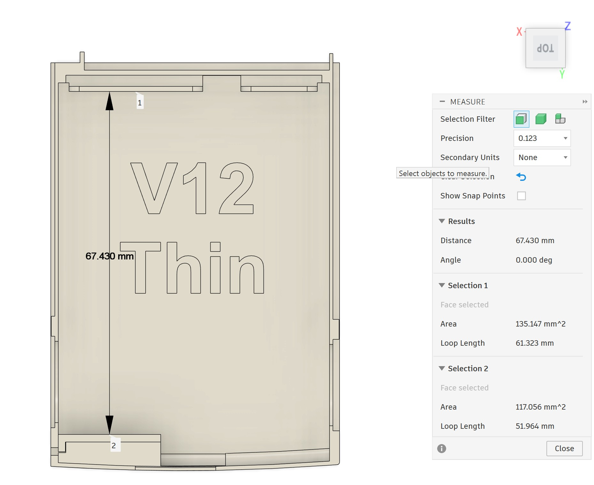
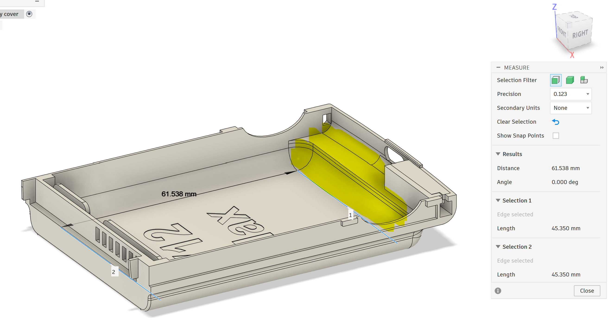

# HP iPAQ hx4700 — kryty baterie Thin a Max

[English](README.md)

Tohle jsou moje náhradní kryty baterie pro **HP iPAQ hx4700** ve dvou verzích: **Thin** a **Max**. Kromě krytů pracuji i na nabíjecí elektronice.

**Zatím to není finální verze.** Kryt má ještě pár much, třeba ostrý roh, který potřebuje doladit. Prostor pro elektroniku se nejspíš také změní podle toho, kam nakonec přijdou body pro uchycení PCB a konektor. S dalšími úpravami krytu i rozložení elektroniky tedy ještě počítám.

## Stažení

**[Stáhnout Thin + Max — ZIP se STL, v0.1.3](https://github.com/Iron-panda666/hp-ipaq-hx4700-battery-covers/raw/refs/heads/main/releases/hp-ipaq-hx4700-Thin-Max-v0.1.3.zip)**

V jednom ZIPu jsou oba kryty a díly **Holder**, **Lever** a **Lever cover**, celkem pět STL souborů. Přibalil jsem i licenci, popis projektu a náhledy Thin a Max. Nabíjecí elektronika součástí balíčku není.

Balíček a jeho kontrolní součet najdeš ve složce [`releases/`](https://github.com/Iron-panda666/hp-ipaq-hx4700-battery-covers/tree/main/releases). Ověřené možnosti článků, úplný návod na sestavení a podrobný tiskový profil doplním, až budou vyřešené.

## Jak vypadá Thin

[Měření šířky](docs/images/Thin02.png) · [Měření detailu](docs/images/Thin03.png)

## Jak vypadá Max

Do žlutě označeného místa plánuji nabíjecí PCB, modul USB-C PD a konektor. Rozmístění se ještě může změnit.

[Měření délky](docs/images/Max01.png) · [Měření šířky](docs/images/Max02.png)

## Tisk a pružina

Díly jsem tiskl metodou **FDM na Bambu Lab X1C s tryskou o průměru 0,2 mm**. Pro jemnější povrch a drobné detaily bych zvážil **SLA resinovou tiskárnu**.

K sestavení budeš potřebovat také malou **tažnou pružinu (extension spring)** s těmito parametry:

| Co hledat | Požadavek |
| --- | --- |
| Vnější průměr | **Nejvýše 1,8 mm, ideálně 1,5 mm** |
| Celková délka | **4–5 mm** |
| Zakončení | **Uzavřená očka na obou koncích, ne otevřené háčky** |
| Poloha oček | **Obě očka vystředěná v ose pružiny**, ne vyosená do strany |
| Průměr drátu | Přibližně **0,2 mm** |

## Baterie a nabíjení

**Prozatím je potřeba použít původní BMS / elektroniku z originální baterie HP iPAQ hx4700.** Náhradu této desky zatím nemám zveřejněnou.

U varianty **Max** bude žlutě označené místo v návrhu nejspíš sloužit pro **nabíjecí PCB, modul USB-C PD a konektor**. Přesné rozmístění ještě není definitivní.

Návrh vlastní PCB už mám víceméně vyřešený, s trochou pomoci od **Claude a Codexu**. Jenže výroba a osazení pouhých **pěti desek** vychází podle zvolené služby na **185–555 USD (asi 165–495 EUR)**. Za pět desek je to upřímně dost.

Prozatím tedy použiji **hotové moduly a součástky z AliExpressu, Amazonu, Mouseru, DigiKey nebo TME**. Konečný seznam součástek a zapojení ještě zveřejněné nejsou.

U vlastní desky zvažuji **USB-C Power Delivery (PD)** a blokování souběžného nabíjení: při připojení **22pinového konektoru** by se nabíjení přes USB-C vypnulo a při aktivním nabíjení přes USB-C by se blokovalo nabíjení přes 22pin. Nabíjelo by se vždy jen z jednoho vstupu. Prioritu vstupů a chování při přepínání ještě musím dořešit.

Na tomhle ještě pracuji. PD, přepínání vstupů, schéma ani ověřené elektrické parametry zatím nejsou k dispozici.

## Poděkování

Díky komunitě **[r/OldHandhelds](https://www.reddit.com/r/OldHandhelds/)** za podporu tohohle projektu! 🙂

## Licence

Modely krytů a popis projektu dávám pod **[CC BY-NC 4.0](https://creativecommons.org/licenses/by-nc/4.0/deed.cs)**. Pro nekomerční použití je můžeš tisknout, sdílet i upravovat. Při sdílení uveď autora **Iron-panda666 aka Tomket**, zachovej přiložené informace o autorství a licenci, přidej odkaz na licenci a napiš, co jsi změnil. V balíčku najdeš [úplné znění licence](LICENSE) i [informace o autorství](ATTRIBUTION.md).

Pokud chceš kryty prodávat nebo projekt využít komerčně, [ozvi se mi přes GitHub](https://github.com/Iron-panda666) a domluvíme samostatnou licenci.

Jde o můj vlastní nezávislý projekt, ne o oficiální produkt HP ani projekt s jeho podporou. Názvy **HP** a **iPAQ** používám proto, aby bylo jasné, pro jaké zařízení kryty jsou; patří svým vlastníkům. Licence pokrývá jen práva, která mohu udělit já. Nedává práva k cizím ochranným známkám, logům ani patentům. Podrobnosti jsou v [rozsahu licence](https://creativecommons.org/licenses/by-nc/4.0/legalcode.en#s2b) a [podmínkách HP](https://www.hp.com/us-en/terms-of-use.html).

Balicí skript ve složce `tools/` má vlastní [licenci MIT](https://github.com/Iron-panda666/hp-ipaq-hx4700-battery-covers/blob/main/tools/LICENSE). Firmware tu zatím není; pokud přibude, dostane samostatnou softwarovou licenci.
