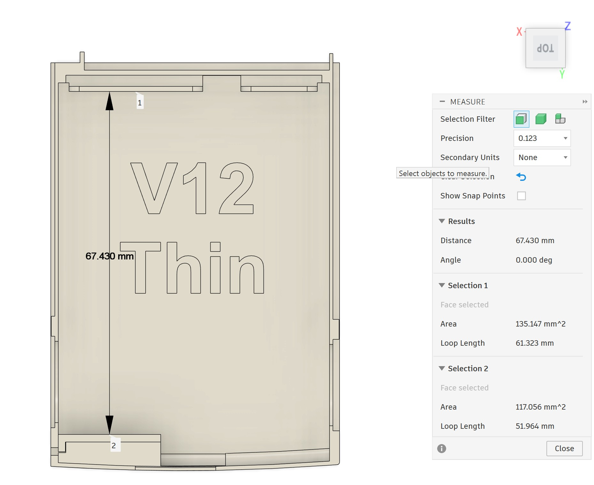

# HP iPAQ hx4700 — Thin & Max Battery Covers

[Česky](README.cs.md)

These are my replacement battery covers for the **HP iPAQ hx4700**, in two versions: **Thin** and **Max**. I'm also working on a charging solution to go with them.

**This isn't the final version yet.** There are still a few things to sort out, including a sharp corner. The space for the electronics will probably change once I've settled on the PCB mounting points and connector position, so expect more changes to the cover and layout.

## Download

**[Download Thin + Max — STL ZIP, v0.1.3](https://github.com/Iron-panda666/hp-ipaq-hx4700-battery-covers/raw/refs/heads/main/releases/hp-ipaq-hx4700-Thin-Max-v0.1.3.zip)**

One ZIP contains both covers, plus the **Holder**, **Lever** and **Lever cover** parts — five STL files in total. The license, project notes and Thin previews are included too. The charging electronics aren't part of the download.

The download and its checksum are in [`releases/`](https://github.com/Iron-panda666/hp-ipaq-hx4700-battery-covers/tree/main/releases). I'll add the confirmed cell options, full assembly instructions and a detailed print profile as the project develops.

## A look at Thin

[Width measurement](docs/images/Thin02.png) · [Detail measurement](docs/images/Thin03.png)

## Printing and the spring

I printed the parts on a **Bambu Lab X1C using FDM and a 0.2 mm nozzle**. For a cleaner finish on the tiny parts, I'd consider an **SLA resin printer**.

You'll also need a small **extension spring** with the following dimensions and ends:

| What to look for | Requirement |
| --- | --- |
| Outer diameter | **1.8 mm maximum; ideally 1.5 mm** |
| Overall length | **4–5 mm** |
| Ends | **Closed eyes (loops) at both ends, not open hooks** |
| Eye position | **Both eyes centered on the spring axis**, not offset to one side |
| Wire diameter | About **0.2 mm** |

## Battery and charging

**For now, you'll need to reuse the original BMS / electronics board from an original HP iPAQ hx4700 battery.** I haven't released a replacement for that board.

For **Max**, the yellow-marked area in the design will probably be home to the **charging PCB, USB-C PD module and connector**. The exact arrangement may still change.

I've more or less got the custom PCB design worked out, with a bit of help from **Claude and Codex**. But getting just **five boards made and assembled** comes to **US$185–555 (about €165–495)**, depending on the assembly service. Pretty steep for five boards, honestly.

So for now, I'll go with **off-the-shelf modules and parts from AliExpress, Amazon, Mouser, DigiKey or TME**. I haven't published the final parts list or wiring yet.

For a custom board, I'm considering **USB-C Power Delivery (PD)** and a way to keep the two charging inputs from being active together: connecting the **22-pin connector** would disable USB-C charging, and active USB-C charging would block charging through the 22-pin connector. Only one input would charge at a time. I still need to settle the priority and switching behavior.

I'm still working on this. PD, input switching, schematics and verified electrical specifications aren't available yet.

## Thanks

Thanks to the folks at **[r/OldHandhelds](https://www.reddit.com/r/OldHandhelds/)** for supporting this project! 🙂

## License

The cover models and these project notes are under **[CC BY-NC 4.0](https://creativecommons.org/licenses/by-nc/4.0/)**. You can print, share and modify them for non-commercial use. If you share them, credit **Iron-panda666**, keep the supplied notices, link to the license and say what you've changed. The [full license](LICENSE) and [attribution details](ATTRIBUTION.md) are included.

If you'd like to sell printed covers or use the project commercially, [contact me on GitHub](https://github.com/Iron-panda666) about a separate license.

This is my own independent project, not an official HP product or something endorsed by HP. **HP** and **iPAQ** are mentioned to identify the device the covers fit; the names belong to their respective owners. The project license only covers rights I can license — it doesn't grant rights to third-party trademarks, logos or patents. See the [license scope](https://creativecommons.org/licenses/by-nc/4.0/legalcode.en#s2b) and [HP's trademark terms](https://www.hp.com/us-en/terms-of-use.html).

The packaging script in `tools/` has its own [MIT license](https://github.com/Iron-panda666/hp-ipaq-hx4700-battery-covers/blob/main/tools/LICENSE). There's no firmware in this project yet; any future firmware will need its own software license.
